<p align="center">
  
</p>

<p align="center">
  <a href="https://github.com/baranmerez/Auspex-Augur/actions/workflows/ci.yml"></a>
  <a href="LICENSE"></a>
  
  
  
  
</p>

<p align="center">
  <b>Let AI agents explore and analyze your PostgreSQL databases — without ever being able to write.</b>
</p>

<p align="center">
  <a href="#-what-you-get">Features</a> ·
  <a href="#-how-it-works">How it works</a> ·
  <a href="#-example-session">Example</a> ·
  <a href="#%EF%B8%8F-safety">Safety</a> ·
  <a href="#%EF%B8%8F-desktop-app">Desktop app</a> ·
  <a href="#-quick-start">Quick start</a> ·
  <a href="#-tools">Tools</a> ·
  <a href="#-documentation">Docs</a>
</p>

<p align="center">
  
</p>

## 🎯 Analysis only, no changes

Auspex does one job: **reading and analyzing your data with SQL**. It runs read-only queries and never executes a change.

> **Auspex does the work; the risky step stays with you.** It explores, analyzes and even drafts the change script, then hands it over. Running a change is always your call.

<p align="center">
  
</p>

- ✅ **It does**: explore schemas, run `SELECT` queries, read query plans, build and schedule reports, remember what it learns.
- 📝 **It drafts change scripts but never runs them**: `INSERT`, `UPDATE`, `DELETE` and DDL go into a file that starts with `BEGIN`, ends with `ROLLBACK`, has no `COMMIT` and needs a `WHERE` on every `UPDATE` and `DELETE`. You review it, run it in your SQL client, and swap `ROLLBACK` for `COMMIT` once the results look right.
- 🚫 **It never guesses**: no default database, no passwords outside pgpass, and the viewer never touches a database.

## ➕ Why Auspex

- **Safe to hand to an agent**: safety comes from the database role, not from trusting the model.
- **Light on tokens and on the database**: batch tools, a per-profile query budget, and reports rendered from a template.
- **Accountable**: every call is in the audit log, so you see exactly what the agent did.
- **Gets smarter with use**: schema memory lets each conversation pick up where the last one ended.
- **Open and portable**: MIT licensed, works with any MCP client, and its logs, memory and reports stay in local files.

## ✨ What you get

- 🛡️ **Read-only by construction**: a `SELECT`-only role plus four code layers. Writes are refused everywhere.
- 📜 **Every call audited**: a daily JSONL log with SQL, duration, row count and errors, including the calls that were refused.
- 🔎 **Fast exploration**: search, describe up to 50 tables at once, and get fill rates, fan-out and related tables in a handful of statements.
- 📚 **Report library**: versioned drafts, approval by you, presets, date ranges, and a fixed HTML template that costs no tokens.
- ⏰ **Scheduled runs**: daily or weekly reports, with catch-up after downtime and an optional desktop notification.
- 🧠 **Schema memory**: tables, relations, rules, column scores and meanings found in your code are remembered as you work.
- 📊 **Viewer and desktop app**: audit charts, reports, relation map, table pages and themes. Neither ever connects to a database.
- 🔌 **Any MCP client**: Claude Code, Codex, Cursor, VS Code and others, with five bundled skills and prompts.


## 🧭 How it works

<p align="center">
  
</p>

- The agent calls Auspex over MCP (stdio) and must name a profile. There is no default database.
- Auspex checks the SQL, runs it in a `READ ONLY` transaction through a cursor, and always rolls back.
- Logs, memory and reports are local files under `~/.auspex`. The viewer reads only those files.


## 💬 Example session

<p align="center">
  
</p>

- You ask in plain words. The agent checks its memory first, so a known table costs no queries.
- Every step is a tool call you can follow in the audit log.
- Nothing is approved until you say so.


## 🛡️ Safety

<p align="center">
  
</p>

1. **SQL guard**: one statement only, read-only keywords, no side-effect functions.
2. **READ ONLY transaction**: statement, lock and idle timeouts; every call ends with `ROLLBACK`.
3. **Cursor and extended protocol**: stacked statements are rejected by the server.
4. **Read-only role**: the real guarantee. It is checked on first use, and a role that can write blocks the profile.
5. **Audit log**: every database call is logged, including the ones that were rejected.

> [!WARNING]
> Passwords live in pgpass only. Auspex refuses to start if it finds one in a connection string or in `profiles.json`.

Details: [docs/safety.md](docs/safety.md)


## 🖥️ Desktop app

A small native app (about 3 MB) that sits in the tray and reads `~/.auspex` directly, with no server to start.

<p align="center">
  
</p>

- 📈 **Overview and operations**: activity charts, slowest queries, recent errors, and the full SQL log with filters and CSV export.
- 📚 **Reports**: browse the library tree, preview results, approve or revoke drafts, pin favorites, and copy an *Ask Claude* prompt.
- 🗺️ **Schema**: relation map, ER diagram and a timeline of schema changes.
- 🧾 **Table pages**: columns by importance with their meanings, keys, triggers and the reports that use the table, plus search and grouping. You can give your own column scores here.
- 📌 **Rules**: every business rule and note in one list, where you can archive outdated ones.
- 🎨 **Themes**: five built-in themes and a theme studio, with an English or Turkish interface.
- 🔒 **No database access**: the app only reads local files, and `Start with Windows` keeps it ready in the tray.

The same screens run in the browser with `npm run viewer`. Details: [docs/viewer.md](docs/viewer.md)


## 🚀 Quick start

**You need** Node.js 20+ and a PostgreSQL server where you can create a role. Building the desktop app also needs Rust and WebView2.

```bash
git clone https://github.com/baranmerez/Auspex-Augur.git auspex
cd auspex && npm install && npm test
```

1. **Create the role** with [`scripts/create-auspex-role.sql`](scripts/create-auspex-role.sql), then grant schemas with [`scripts/grant-schemas-readonly.sql`](scripts/grant-schemas-readonly.sql).
2. **Store the password in pgpass** as `host:port:database:Auspex:password`: `%APPDATA%\postgresql\pgpass.conf` on Windows, `~/.pgpass` elsewhere.
3. **Add a profile** to `~/.auspex/profiles.json`. See [`profiles.example.json`](profiles.example.json).
4. **Register the server** in your MCP client. See [docs/clients.md](docs/clients.md).

> [!TIP]
> Say "work on the `example` database" and the agent starts right away. If you don't name one, it lists the profiles and asks.


## 🧰 Tools

| Group | Tools |
|---|---|
| 🗂️ Profiles | `list_profiles` · `check_profile` |
| 🔎 Explore | `search` · `list_schemas` · `list_tables` · `describe_table` · `describe_tables` · `describe_functions` · `profile_tables` · `relation_stats` |
| ▶️ Query | `query` · `explain` · `export_csv` |
| 📚 Reports | `save_report` · `run_report` · `approve_report` · `list_reports` · `render_reports` · `share_report` · `save_execute_script` |
| 🧠 Memory | `table_knowledge` · `remember` · `score_columns` · `scanned_files` |

Every tool, with its limits and error codes: [docs/tools.md](docs/tools.md)

## 📖 Documentation

| Page | What's inside |
|---|---|
| [Safety layers](docs/safety.md) | Each layer in detail, and what the audit log records |
| [Tools](docs/tools.md) | All tools, CSV export, batch exploration, long queries, errors |
| [Reports and schedules](docs/reports.md) | Report library, approval, presets, date ranges, scheduled runs |
| [Schema memory](docs/schema-memory.md) | Notes, relations, column importance, meanings from code |
| [MCP clients, skills and prompts](docs/clients.md) | Setup for each client, bundled skills and prompts |
| [Viewer and desktop app](docs/viewer.md) | Every tab, table pages, themes, approving reports |
| [Configuration](docs/configuration.md) | Profiles file, environment variables, recommended role |
| [Tests](docs/testing.md) | Unit and integration tests, CI |

## 🧪 Tests

```bash
npm test             # unit tests, no database needed
npm run test:local   # integration tests against a local PostgreSQL
```

## 📄 License

MIT, see [LICENSE](LICENSE).
