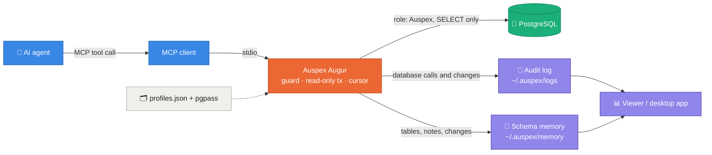

<p align="center">
  
</p>

<p align="center">
  <a href="https://github.com/baranmerez/Auspex-Augur/actions/workflows/ci.yml"></a>
  <a href="LICENSE"></a>
  
  
  
  
</p>

<p align="center">
  <b>Let AI agents explore and analyze your PostgreSQL databases — without ever being able to write.</b><br>
  Guarded queries · full audit log · local viewer · desktop app · works with any MCP client
</p>

<p align="center">
  <a href="#-quick-start">Quick start</a> ·
  <a href="#-how-it-works">How it works</a> ·
  <a href="#%EF%B8%8F-safety-layers">Safety</a> ·
  <a href="#-tools">Tools</a> ·
  <a href="#-register-with-an-mcp-client">MCP clients</a> ·
  <a href="#-viewer-and-desktop-app">Viewer</a> ·
  <a href="#%EF%B8%8F-configuration">Configuration</a>
</p>

---

> [!IMPORTANT]
> Auspex Augur is **read-only by design**. The guarantee comes from a database
> role that only has `SELECT`; four code layers and an audit log sit on top of
> it. Nothing in this project can insert, update, delete or change a schema.

## ✨ Features

<table>
  <tr>
    <td width="33%" valign="top"><h3>🛡️ Safe by construction</h3>Read-only role, SQL guard, <code>READ ONLY</code> transactions, cursor-only execution. Writes are refused at every layer that can see them.</td>
    <td width="33%" valign="top"><h3>🔎 Built for exploration</h3>Search tables and columns across schemas, describe structure and relationships, sample data, read plans with <code>EXPLAIN ANALYZE</code>.</td>
    <td width="33%" valign="top"><h3>📜 Everything audited</h3>Every database call — including ones the SQL guard rejects — and every report, script and memory-note change you ask for lands in a daily JSONL log with duration, row count and errors (see the audit log layer for what is not logged).</td>
  </tr>
  <tr>
    <td valign="top"><h3>🗂️ Many databases</h3>Named profiles in one file, no default database: the agent must name the database, and is told to ask you first.</td>
    <td valign="top"><h3>📊 Viewer &amp; desktop app</h3>Charts, filters and per-query details in a local web viewer or a 3 MB Tauri tray app.</td>
    <td valign="top"><h3>🔌 Any MCP client</h3>Plain stdio MCP server: Claude Code, Codex, Cursor, VS Code or anything else that speaks the protocol.</td>
  </tr>
  <tr>
    <td valign="top"><h3>📚 Report library</h3>Approved queries per database, schema and category, with plan, timings and history in a fixed HTML template that costs no tokens.</td>
    <td valign="top"><h3>🧠 Schema memory</h3>Tables, keys, relations, business rules and schema changes are remembered as you explore, without crawling the catalog.</td>
    <td valign="top"><h3>🗺️ Relation map</h3>A force-directed graph and an ER diagram of everything the memory knows, with unexplored neighbors to visit next.</td>
  </tr>
</table>

## 🚀 Quick start

```bash
git clone https://github.com/baranmerez/Auspex-Augur.git auspex
cd auspex && npm install && npm test
```

1. **Create a read-only role** on your server with
   [`scripts/create-auspex-role.sql`](scripts/create-auspex-role.sql), then grant
   schemas with [`scripts/grant-schemas-readonly.sql`](scripts/grant-schemas-readonly.sql).
2. **Store the password in pgpass** (`%APPDATA%\postgresql\pgpass.conf` on
   Windows, `~/.pgpass` elsewhere): `host:port:database:Auspex:password`.
3. **Add a profile** to `~/.auspex/profiles.json` (see
   [`profiles.example.json`](profiles.example.json)).
4. **Register the server** in your MCP client ([see below](#-register-with-an-mcp-client)).

> [!TIP]
> Start the agent with "work on the `shop` database" and it goes straight to
> work. If you don't name one, it lists the profiles and asks.

## 🧭 How it works



## 🛡️ Safety layers

<p align="center">
  
</p>

<details>
<summary><b>Details of each layer</b></summary>

1. **SQL guard** (`src/sqlGuard.js`): single statement only; must start with
   `SELECT`/`WITH`/`VALUES`/`TABLE`; rejects data-modifying CTEs, `SELECT INTO`,
   `FOR UPDATE` and side-effect functions (`set_config`, `pg_terminate_backend`,
   `pg_sleep`, `lo_*`, `dblink*`, `pg_read_*`, `nextval`...), also when the
   name is quoted, schema-qualified or Unicode-escaped (comments and a lone
   carriage return are read the way PostgreSQL reads them), and built-ins that
   run SQL given as text (`query_to_xml*`, `cursor_to_xml*`, `ts_stat`,
   `ts_rewrite`). Runs before connecting. It is a lexical check only: functions
   that call these internally are not seen, so what the role may EXECUTE is
   limited by its grants.
2. **Transaction wrapper** (`src/db.js`): every call runs in
   `BEGIN ... READ ONLY` with `statement_timeout`, `lock_timeout` and
   `idle_in_transaction_session_timeout`, and always ends with `ROLLBACK`.
3. **Cursor + extended protocol:** queries run as `DECLARE CURSOR FOR <query>`
   over the extended protocol, which rejects stacked statements and
   data-modifying CTEs at the server.
4. **Database role (the real guarantee):** the role only has `CONNECT`, `USAGE`
   and `SELECT`. Everything else is defense in depth. Auspex checks this
   instead of trusting it: on the first call to each profile it reads the
   catalog (`src/roleCheck.js`). Superuser, `BYPASSRLS`, `REPLICATION`,
   `CREATEROLE`, membership in `pg_write_all_data` or the server-file roles, or
   any table it can write (table or column grants) **block** the profile: no
   query runs on it until the role is fixed. CREATE on a schema or the
   database, `CREATEDB` and `default_transaction_read_only` off are
   **warnings** only, since the READ ONLY transaction already stops them. The
   result is in `list_profiles`, `check_profile` runs it again, and the audit
   log and the viewer's profile cards show it.
5. **Audit log:** appended to `<data dir>/logs/YYYY-MM-DD.jsonl`.
   - Database calls (`query`, `explain`, `export_csv`, `run_report`, catalog
     tools): time, source, tool, profile, SQL, params, row count, duration,
     error — also when the SQL guard rejects the query.
   - Library and memory changes (`save_report`, `approve_report`,
     `save_execute_script`, `render_reports`, `share_report`, `remember`): which report or
     note, the SQL hash and version or note id and status, and the error;
     for a report or script saved into a script root also the root, folder
     and file name and the written paths.
     The SQL text, note text, evidence and reasons are not logged.
   - Not logged: tools that only read local files (`table_knowledge`,
     `list_reports`, `list_profiles`) and calls the MCP SDK rejects for
     invalid arguments before any handler runs.
   - Writing is best effort: if the log cannot be written, the call still
     runs and the failure goes to stderr. The file is plain appendable JSONL
     on your disk, readable and editable by your user account; it is a record,
     not tamper-proof evidence.

</details>

> [!WARNING]
> Never put a password in a connection string or in `profiles.json` — Auspex
> refuses to start if it finds one, whether in `user:password@` or as a
> `?password=` / `?sslpassword=` option, in the file or in `AUSPEX_DB_<NAME>`.
> Passwords belong in pgpass only.

## 🧰 Tools

| Tool | What it does |
|---|---|
| 🗂️ `list_profiles` | Configured profiles (description, host, database, user, timeout limit, role check; never passwords) and script roots (name and folder) |
| 🔐 `check_profile` | Checks that a profile's database role is read-only; a role that can write blocks the profile |
| 🔎 `search` | Tables, views, columns, functions and triggers whose name or comment matches a text, across all schemas, in one statement; with estimated rows and privileges; optionally function source text too (`searchSource`) |
| 📁 `list_schemas` | Non-system schemas with owner, relation count, usage privilege, comment |
| 📋 `list_tables` | Tables/views in a schema with estimated rows, size, SELECT privilege, comment; optional ILIKE filter |
| 🧬 `describe_table` | Columns (with identity, generated and owned sequence), types, defaults, comments, constraints incl. checks, indexes, incoming FKs, triggers, row level security, partitioning, view definition; records the table in the schema memory and reports changes since the last time |
| 🧬 `describe_tables` | The same structure for up to 50 tables in one call, with 6 catalog statements (7 with a view) however many tables; compact one-line-per-item summary by default, `detail: "full"` for every definition; unknown names are reported per table; each table is recorded in the schema memory |
| 🧩 `describe_functions` | Up to 50 functions by `schema.name` (every overload) or by name pattern: signature, language, volatility, SECURITY DEFINER, owner, calling triggers and the `pg_get_functiondef` text (capped, `truncated` flag); 1 statement |
| 📏 `profile_tables` | Up to 30 tables in one call: estimated rows, per-column fill rate and distinct count on a sample, and fan-out over a parent table (optionally in a window and with `parentFilter` conditions); at most 3 statements; counts and ratios only, never row values |
| 🕸️ `relation_stats` | Up to 50 center tables in one call: their instance tables (referenced by foreign key) and dependent tables (referencing them), ranked by estimated linked rows from planner statistics; at most 2 statements; no table data is read |
| ▶️ `query` | One read-only statement, max `AUSPEX_MAX_ROWS` rows, `$1..$n` params, optional `timeoutSeconds` |
| 🧠 `explain` | Estimated plan by default; `analyze: true` runs `EXPLAIN (ANALYZE, BUFFERS)` read-only, under the timeout, rolled back |
| 📤 `export_csv` | Streams the result to a new UTF-8 CSV file (`<time>_<random>_<name>.csv`, never overwrites) within a row, size and total-time budget; returns only path, columns, row count, size and `stopReason` when a limit cut it short |
| 📝 `save_report` | Saves a read-only query as a versioned report draft in the library; with `root`, `folder` and `fileName` also as a new `.sql` file in a configured script root |
| 🏁 `run_report` | Runs a report: plan + timings + masked preview, history, regenerated HTML; returns a compact summary |
| ✅ `approve_report` | Moves a draft into `SELECT/` after the user approved it |
| 📚 `list_reports` / 🎨 `render_reports` | Lists the library; re-renders every report HTML from stored JSON |
| 📨 `share_report` | Writes a copy of a report to send to someone: masked preview and figures only, no SQL, plan, parameters or history |
| 🧾 `save_execute_script` | Writes a change script into `EXECUTE/` for a human to run — never executed by Auspex; with `root`, `folder` and `fileName` also as a new file in a configured script root (for example the DBeaver Scripts folder) |
| 🧠 `table_knowledge` | What the schema memory knows about a table — key and used columns, relations, table notes, database-wide notes, recent changes, unexplored neighbors — without touching the database |
| 📌 `remember` | Adds, confirms or archives a note: a rule the user stated, an observation backed by evidence, or an unconfirmed inference |

### Choosing the database

There is no default profile. Every tool except `list_profiles` requires an
explicit `profile`, and a call without one is rejected with the list of known
profiles. The server instructions tell the model to ask the user which
database to use unless the user named one in the current conversation, and to
confirm before switching. The code guarantees the explicit choice; asking the
user is model behavior.

### CSV for spreadsheets

`export_csv` writes exact values by default (`mode: "raw"`), which is right
for scripts and other tools. When a person will open the file in a
spreadsheet, use `mode: "spreadsheet"`: text cells that start with `=`, `+`,
`-`, `@`, a tab or a carriage return get a leading apostrophe so they are
shown as text instead of being run as a formula. Number, date, time, boolean
and uuid columns are never changed, so a real `-5` stays a number. Columns of
any other type count as text, and column names get the same treatment. The
viewer's Operations CSV download applies the same rule to every text cell
(SQL, errors, profile, parameters); its JSON download stays exact. The rule
follows the common CSV-injection guidance; it is covered by tests on the
written file and the viewer download, not yet checked by opening the files in
Excel, LibreOffice or Google Sheets. It is a mitigation, not a guarantee:
spreadsheet behavior differs per application and the apostrophe can be lost
when a file is saved and reopened (see the OWASP CSV Injection page).

### CSV export budget

Each `export_csv` call has a row cap, a size cap and a total time cap
(`AUSPEX_EXPORT_MAX_ROWS`, `_BYTES`, `_MS`). The size cap counts every byte
written: byte order mark, header line, quoting and CRLF. If the header alone
does not fit, the call fails and no file is kept. The time budget starts once
the read-only transaction is open and ends when the file is closed; it covers
every FETCH, every write (including waits for a slow disk) and closing the
file. Near the deadline each FETCH runs with `statement_timeout` lowered to
the remaining time (never above the call's own timeout), so PostgreSQL cancels
it at the deadline and the connection goes back to the pool clean. Hitting a
cap ends the file at the last complete row with `stopReason` `rows`, `bytes`
or `time`; a time stop before the first batch arrived fails without a file.

Tolerance: a FETCH the server does not cancel is given 2 s past the deadline,
then its connection is dropped (never reused); closing the file is given up to
2 s past the deadline, after which the call fails and removes the file it
created. So a call returns within about `AUSPEX_EXPORT_MAX_MS` + 4 s in the
worst case, usually within milliseconds of the deadline.

### Exploring many tables

Exploring N tables one by one costs N round trips (a `describe_table` and a
measuring query per table), all of them in the audit log. `describe_tables`
and `profile_tables` take a list instead and use a constant number of
statements in one READ ONLY transaction with one audit entry, whether the list
has 1 table or 30: `describe_tables` sends 6 catalog statements (7 when a view
or materialized view is listed); `profile_tables` sends 1 catalog lookup, 1
column-statistics statement for all tables (`UNION ALL`) and, with `parent`,
1 fan-out statement, so at most 3 (field `statements`). Column statistics are
taken on a sample of `sampleRows` rows per table (default 20000, max 200000):
`TABLESAMPLE SYSTEM` plus `LIMIT` when the estimate is larger, otherwise a
plain `LIMIT` scan. Fan-out uses the child's single-column foreign key to
`parent.key`, or a column given as `schema.table:column`. The parent rows can
be narrowed by `window` (`from <= column < to`) and by `parentFilter`, up to 5
conditions `{ column, op, value | values }` with `op` one of `=`, `<>`, `>`,
`>=`, `<`, `<=` (one `value`), `in`, `not in` (`values`, 1 to 100) or
`is null`, `is not null` (neither), e.g.
`[{ "column": "status_code", "op": ">", "value": 50 }]`. All conditions are
ANDed; each column must exist in the parent table (otherwise
`INVALID_INPUT`), and every value is a bound parameter, never SQL text. The
fan-out stays one statement. Table and column
names are checked against the catalog, quoted, and the generated SQL passes the
same guard as user queries; there is no free SQL. The server instructions tell
the model to prefer these two tools over per-table loops.

`describe_tables` answers with `detail: "summary"` by default, because the
full structure of a dozen real tables can run to well over 100k characters.
Per table the summary has `estRows`, `comment`, one line per column
(`name type [not null] [PK] [FK -> schema.table(column)] [identity]
[generated] [default <value> | has default] [no SELECT]`; defaults longer
than 30 characters are only flagged), one line per constraint other than
single-column foreign keys (`name definition`), per index (`name [unique]
[method] (columns)`) and per trigger (`name TIMING EVENTS`), each line cut at
120 characters, `referencedBy: { count, tables }` with the first 10 incoming
foreign keys by table name, and `viewDefinitionOmitted` instead of a view's
definition; `rowLevelSecurity`, `partitioning` and `partitionOf` only when
set. The field `note` repeats this format. `detail: "full"` returns exactly
the earlier answer (column comments, check, index and trigger definitions,
view definitions). Both modes send the same statements and record the schema
memory from the full catalog data. On the test fixtures the summary is 59 %
(10 plain tables) to 79 % (a table with checks, indexes, a trigger and 12
incoming foreign keys, plus a view) smaller than the full answer.

### Reading table DDL, triggers and functions

For integration work (for example "show the import table for one firm and
every function and trigger around it, then design the same for another firm")
the catalog tools return the structure needed to rebuild it:

- `describe_table` / `describe_tables` per table: columns with `identity`
  (`always` / `by default`), `generated` (`stored`) and the owned `sequence`
  (serial or identity) when set; for a generated column `default` holds its
  expression. Constraints include check definitions. `triggers` lists user
  triggers (internal foreign key triggers are left out) with `timing`,
  `events`, `level`, `enabled` (`enabled`, `disabled`, `replica only`,
  `always`), `function`, `whenCondition` and the full `definition`
  (`pg_get_triggerdef`). `rowLevelSecurity` is `{ enabled, forced }`; a
  partitioned table has `partitioning: { key, partitions }`, a partition
  `partitionOf: { parent, bound }`. The table comment is `comment`. All of it
  comes from the same 6 statements (7 with a view), one of them for triggers.
  `describe_tables` returns these fields with `detail: "full"`; its default
  summary keeps only trigger names, timing and events.
- `describe_functions` reads functions, procedures and aggregates by
  `schema.name` (all overloads) or by a name pattern (at most 50, `truncated`):
  `arguments`, `returns`, `kind`, `language`, `volatility`, `securityDefiner`,
  `strict`, `parallel`, `config` (`SET` options such as `search_path`),
  `owner`, `canExecute`, `comment`, `usedByTriggers` and `definition`
  (`pg_get_functiondef`, cut at `maxChars`, default 20000, with
  `definitionLength` and `truncated`; null for aggregates). One statement.
- `search` also matches function names and comments and trigger names
  (`includeRoutines`, default true), and with `searchSource: true` the source
  text of functions (`matchedIn: "source"`; the text itself is not returned).
  Still one statement and at most 500 matches, relations first.

Only the system catalog is read (no table data, no server files).

### Ranking related tables

`relation_stats` answers "which neighbours of this table matter most" without
reading any table. For each center table it lists:

- **instance** tables: tables the center references by foreign key (for
  example `sales.orders -> sales.order_status`);
- **dependent** tables: tables that reference the center (for example
  `sales.order_lines -> sales.orders`).

Each list is sorted by `linkedRows`, then by the table's estimated rows
(`tableEstRows`), then by name; equal figures share a `rank`. An item is
`{ relation, constraint, columns, refColumns, linkedRows, stats, tableEstRows,
rank, explored }`; `columns` are the referencing side's key columns.

`linkedRows` estimates the rows that link through the key, from statistics
only: the referencing table's `reltuples` (the dependent table, or the center
for an instance table) times `1 - null_frac` of its key column in `pg_stats`.
For a multi-column key the largest `null_frac` is used, so it is an upper
bound. When the referencing table was never analyzed (`reltuples < 0`) or
`pg_stats` has no row for a key column, `linkedRows` is `null` and `stats` is
`"missing"`; it is never reported as 0. `pg_stats` only shows columns the role
may read and hides tables whose row security applies to the role, so missing
statistics can also mean missing privileges. A partitioned table has
statistics only after `ANALYZE` on the parent (autovacuum does not analyze
partitioned parents). Relations without SELECT privilege are not listed, only
counted in `hidden` (`{ instance, dependent }`); a center without SELECT
privilege is reported with an error. Foreign keys cloned onto partitions are
left out (the parent's key stands for them). `schema` limits the neighbours to
one schema.

All centers take at most 2 statements in one READ ONLY transaction (the
relations with their foreign keys, then `pg_stats`), with one audit entry
(field `statements`). The result is recorded in the schema memory: centers and
neighbours are recorded as seen (never as explored), with their row estimates,
and the edges in `graph.json` carry the linked-row figures (see below).

### Large tables and long queries

`query`, `explain`, `export_csv` and `profile_tables` accept `timeoutSeconds`. Without it the
default (30 s) applies; with it the value may not exceed the global or
per-profile ceiling, and a larger value is rejected before connecting. The
server instructions tell the model to prefer estimated row counts over
`count(*)`, check plans with `explain` first, and tell the user before running
anything longer than the default.

### Errors

A failed tool call returns `isError: true` with the readable message as the
first text block (unchanged), followed by a machine-readable envelope, both as
`structuredContent` and as a second text block with the same JSON:

```json
{ "error": { "code": "QUERY_BUDGET_EXCEEDED", "retryable": true, "retryAfterSeconds": 42,
             "budgetScope": "process", "correlationId": "5f0c…" } }
```

Decide from `code` and `retryable`, never from the English text. The envelope
holds no message text, SQL, parameters, row values or connection details;
`sqlState` is the PostgreSQL SQLSTATE when the database raised the error.

| Code | Meaning | Retryable |
|---|---|---|
| `QUERY_BUDGET_EXCEEDED` | Query budget of the profile used up; `retryAfterSeconds` says when the next slot frees. The budget is per profile and per Auspex process (`budgetScope: "process"`), not a database-wide limit | yes, once, after the wait; better batch the work |
| `LOCK_BUSY` | Another Auspex process is writing the report library or schema memory | yes, after a moment |
| `ROLE_REJECTED` | The profile's database role is not read-only | no |
| `SQL_REJECTED` | The SQL guard, or the READ ONLY transaction (SQLSTATE 25006), refused the statement | no |
| `TIMEOUT` | Statement timeout (57014), idle-in-transaction timeout (25P03) or export time limit; lock timeout (55P03) is retryable | lock timeout only |
| `INVALID_INPUT` | Invalid arguments, names or option values, including MCP schema validation | no |
| `PROFILE_INVALID` | Missing or unknown profile | no |
| `NOT_FOUND` | Report, note, relation or column not found | no |
| `PRECONDITION_FAILED` | An earlier step is missing (for example run the current SQL version before approving or sharing) | no |
| `PERMISSION_DENIED` | No privilege on the object (42501) | no |
| `CONNECTION_FAILED` | Could not connect or authenticate (08xxx, 28xxx, 57P01-57P03, 53300, network errors, a connection dropped mid-query); authentication failures are not retryable | network/server only |
| `DISK_ERROR` | A local file could not be written or read (ENOSPC, EEXIST, EACCES, ...) | no |
| `DATABASE_ERROR` | Any other PostgreSQL error; see `sqlState` (serialization failure and deadlock are retryable) | 40001/40P01 only |
| `INTERNAL` | Anything else | no |

Auspex itself never retries. Every tool call gets a `correlationId` (a random
UUID), returned in `_meta.correlationId` of both successful and failed results
and in the error envelope. The audit log entries written by that call carry the
same `correlationId` (including the first-use `role_check`), and failed entries
also `errorCode` and `sqlState`, so a result can be matched to its audit entry
without double counting. Calls rejected by the MCP SDK's schema validation get
the envelope too but are not audited (the handler never ran).

## 📚 Report library

When an analysis query is worth keeping, the agent saves it as a report.
Reports are grouped by database (profile), schema and category, and live in a
user-specific folder outside any repository (`~/.auspex/library`, override
with `AUSPEX_LIBRARY_DIR`):

```
library/
├── _drafts/<db>/<schema>/<category>/<name>.sql|.report.json|.html   work in progress
├── SELECT/<db>/<schema>/<category>/<name>.sql|.report.json|.html    approved reports
└── EXECUTE/<db>/<schema>/<category>/<name>.sql|.execute.json        change scripts for a human (.execute.json: file in a script root)
```

- **The agent only writes SQL.** `run_report` executes it read-only in one
  snapshot (`EXPLAIN (ANALYZE, BUFFERS, VERBOSE, SETTINGS, FORMAT JSON)` plus a
  cursor preview), summarizes the plan, masks personal columns, appends the run
  to the history and fills one fixed HTML template. Rendering costs no tokens.
- **The HTML is self-contained** (data embedded, no external files): stat tiles,
  plan warnings, a plan tree with time share and misestimates, joins read from
  the plan (with the column pairs they use), tables touched, the masked preview,
  run history with a duration chart, and a diff between SQL versions.
- **Develop a query like a car:** every saved SQL change becomes a new version,
  every run is kept (last 100), so you can see what each change did to time,
  cost and plan.
- **Heavy reports:** with `analyze: "auto"` the plan is still read but
  `EXPLAIN ANALYZE` is skipped when the previous run took more than 30 s, so a
  slow query is not executed twice without asking.
- **Approval:** drafts move to `SELECT/` only through `approve_report`, which
  the server instructions restrict to an explicit user approval, or through
  the user's own click in the viewer (see *Approving reports in the viewer*). Approval also
  requires a successful run of the current SQL (`run_report`); an older
  revision's run does not count.
- **Change scripts:** `save_execute_script` only writes files. A script must
  start with `BEGIN`, end with `ROLLBACK`, contain no `COMMIT` and have `WHERE`
  on every `UPDATE`/`DELETE`; whoever runs it with a privileged role swaps the
  final `ROLLBACK` for `COMMIT` after checking the results. The check fails
  closed: no other transaction statement (`END`, `ABORT`, an early `ROLLBACK`,
  a second `BEGIN`, `PREPARE TRANSACTION`) is allowed in between, only
  `SAVEPOINT` / `RELEASE` / `ROLLBACK TO`; `DO` blocks, `CALL`, `CREATE
  PROCEDURE`, `MERGE` and psql backslash commands are rejected because their
  bodies or branches cannot be checked; and each `UPDATE`/`DELETE`, also
  inside a CTE, needs its own `WHERE` (one inside a subquery does not count).
  It is a structural check, not a proof that the script is right: a `WHERE`
  that matches everything (`WHERE true`) passes, and no script is rehearsed
  against a database (Auspex's role cannot write). A human still reviews
  every script.
- **Functions and triggers in change scripts:** `CREATE [OR REPLACE]
  FUNCTION` is allowed with `LANGUAGE plpgsql` or `LANGUAGE sql` (unquoted)
  and exactly one dollar-quoted body (`AS $tag$ ... $tag$`, any tag);
  `CREATE [OR REPLACE] [CONSTRAINT] TRIGGER` is allowed too, so a table
  script and its trigger functions can be one script. The body is masked
  like a string literal: creating a function does not run it, so its
  statements are **not linted** (an `UPDATE` without `WHERE` inside a body
  passes, the same statement outside is rejected). The saved file then
  carries the header line `-- NOTE: function bodies are not linted by
  Auspex; review them before COMMIT`. Other languages, quoted language
  names, single-quoted or SQL-standard (`RETURN` / `BEGIN ATOMIC`) bodies
  are rejected. Warnings: `SECURITY DEFINER`; a later statement that calls
  a function created in the same script (quoted names included), since its
  body runs there; and every `INSERT`/`UPDATE`/`DELETE` after a `CREATE
  TRIGGER` or a function `RETURNS trigger`, since trigger bodies run during
  the dry run.
- **Script roots:** to keep change scripts where you run them (for example
  DBeaver's `General\Scripts`, one folder per topic), name the folder in
  `scriptRoots` in the profiles file or as `AUSPEX_SCRIPT_ROOT_<NAME>` (see
  Profiles file). `save_execute_script` with `root` (the name), `folder`
  (one or two levels joined by `/`, for example `Orders_DB_Scripts_V1` or
  `Orders_DB_Scripts_V1/reports`, created if missing) and `fileName` (ending
  in `.sql`) writes the script to `<root>/<folder>/<fileName>` and keeps the
  `EXECUTE/` copy as the library record (`list_reports` shows its
  `externalFile`; the header names the file). Each folder level and the
  file name is one name of letters (Turkish included), digits, `_`, `-` and
  `.`, at most 80 characters, without `..`, a leading or trailing dot or a
  Windows device name; empty levels, absolute or drive paths and a third
  level are refused. The root must exist; Auspex never creates it. A file
  that already exists is never overwritten (the error proposes the next
  free `NN_` number), and a folder level that resolves outside its parent
  through a link or junction is refused. `replace` only applies to the
  library copy. The lint runs before anything is written. This only writes
  files; no database is touched.
- **Report queries in a script root:** `save_report` takes the same `root`,
  `folder` and `fileName` and writes the read-only query (checked by the SQL
  guard, one statement) as a new `.sql` file with a comment header, for
  running in DBeaver or another tool; the draft lists it under
  `externalFiles`. The change-script lint is not involved. A read-only
  check file with several SELECTs (for example a post-commit check) goes
  through `save_execute_script` wrapped in `BEGIN; ... ROLLBACK;`, which the
  lint already accepts.
- **Several Auspex processes:** two MCP clients or a script can share one
  library and memory folder. Every change runs under a lock file
  (`<library>/.lock`, `<memory>/<profile>/.lock`), so concurrent writers do
  not lose each other's updates and SQL, metadata and HTML stay in step. A
  second writer waits up to 5 s, then gets a "try again" error. A lock whose
  owner process is still alive on this machine is not taken over while it is
  younger than 10 minutes (debugger, sleep); a lock left by a crashed process
  is taken over automatically. Only when the owner cannot be checked
  (unreadable lock file, another host) does a lock older than 30 s expire.
  Past 10 minutes (`maxHoldMs` of `withFileLock`) any lock or leftover
  takeover marker is reclaimed even when its pid looks alive, because the OS
  may have reused the pid of an owner that died holding it; every guarded
  section is short file work, far below that ceiling. Locks are same-host
  only: sharing one library or memory folder between machines over a network
  filesystem is not supported. A crash in the middle of an approval can leave
  it half done.

- **Private report, shared copy:** a report's own HTML is a private working
  file: it embeds the raw SQL, parameters, query plan (with its filter
  expressions) and run history, and says so at the top. To send a report to
  someone, `share_report` writes a separate copy into `exports/` built from an
  allowlist: title, description, category, the masked preview, the
  timing/row figures and the result's SQL version number and run time. It is
  refused when the last results come from a SQL version other than the
  current one (saved but not run yet); run the current version first. SQL,
  plan, parameters, warnings, history and database, schema and server names are left out, not redacted. The title and
  description are kept as written, so keep secrets out of them.

> [!NOTE]
> Masking is a name-based safety net (English and Turkish names, including
> compounds such as `aliciadi`). Free-text and JSON columns can still contain
> personal data; add them to a report's `mask` list. A shared copy is no
> anonymization: its preview rows are exactly what the masking left, so check
> them before sending.

## 🧠 Schema memory

Auspex remembers what it learned about each database in local JSON files
(`~/.auspex/memory/<profile>/`, override with `AUSPEX_MEMORY_DIR`). It grows
with the work and never crawls the catalog on its own:

- **`describe_table`** records the full structure of a table (columns, keys,
  indexes, incoming foreign keys). The next time the same table is described,
  the answer lists what changed: added, dropped, renamed or retyped columns,
  constraints and indexes. Row estimates and comments are not changes. Only the
  system catalog is read, never table data.
- **Plans teach it too:** tables and columns used by `run_report` and `explain`
  are recorded as "seen", with the columns they actually used.
- **Relations** have three levels: `fk` (declared), `used` (joined in an
  approved report) and `suggested` (a column named like another table's
  primary key; unconfirmed until you say so).
- **Notes** are `rule` (stated by the user), `observation` (a finding with
  evidence: the SQL and aggregate figures, dated, never row values) and
  `inference` (the model's interpretation, shown as unconfirmed). Notes on a
  table come back with `table_knowledge`, `describe_table`, `explain` and
  `run_report`, and with `query` when its SQL names the table as
  `schema.table`; database-wide notes come back with `table_knowledge`. They are
  archived with a reason, never deleted.
- **Exploring further:** after a report, `run_report` and `table_knowledge`
  list neighbors that were never described. The server instructions tell the
  model to ask you before looking at them, and then to read their structure
  only.

```
memory/<profile>/
├── tables/<schema>/<table>.json   structure, used columns, change history
├── notes.json                     rules, observations, inferences
├── changelog.jsonl                explored tables, notes and schema changes
└── graph.json                     derived view for the viewer (rebuilt on every change)
```

`graph.json` is `{ profile, generatedAt, summary, nodes, edges, notes,
changelog }`. Nodes and edges, with the optional fields `relation_stats` adds
(absent until it has measured them, so older readers are unaffected):

```
node: { id: "schema.table", schema, table, file?, state: "explored" | "seen" | "unexplored",
        kind, estimatedRows, columnCount, changes, notes,
        estRows?: number | null }       // relation_stats row estimate; null = never analyzed
edge: { level: "fk" | "used" | "suggested", from: "schema.table", to: "schema.table",
        columns: [...], refColumns: [...], // from(columns) references to(refColumns)
        linkedRows?: number | null,      // rows of `from` with the key set; null = stats missing
        estimated?: true,                // linkedRows comes from planner statistics
        statsAt?: "ISO time" }           // when relation_stats measured it (latest wins)
```

`file` is only set for tables with a record (`explored` or `seen`). The table
records keep the measurement (`estRows`, `estRowsAt`, and for centers
`relationStats`), so describing a table again does not drop it.

## 🔌 Register with an MCP client

Auspex is a stdio MCP server. Register it once; databases are managed in the
profiles file, not in the client. Most clients accept this shape:

```json
{
  "mcpServers": {
    "auspex": {
      "command": "node",
      "args": ["/path/to/auspex/src/index.js"]
    }
  }
}
```

Use the server name `auspex` to get tool names like `mcp__auspex__query` in
clients that prefix tools with the server name. Environment variables
(`AUSPEX_HOME`, `AUSPEX_DB_<NAME>`, ...) can go in the client's `env` block.

<details>
<summary><b>Claude Code</b></summary>

```bash
claude mcp add auspex --scope user -- node /path/to/auspex/src/index.js
```

From PowerShell, where `--` is swallowed by the `claude.ps1` shim:

```powershell
claude mcp add-json auspex '{"type":"stdio","command":"node","args":["C:/path/to/auspex/src/index.js"]}' --scope user
```

</details>

<details>
<summary><b>Codex CLI</b></summary>

In `~/.codex/config.toml`:

```toml
[mcp_servers.auspex]
command = "node"
args = ["/path/to/auspex/src/index.js"]
```

</details>

<details>
<summary><b>Cursor</b></summary>

In `~/.cursor/mcp.json` (or `.cursor/mcp.json` in a project), use the
`mcpServers` JSON shown above.

</details>

<details>
<summary><b>VS Code</b></summary>

In `.vscode/mcp.json`:

```json
{
  "servers": {
    "auspex": {
      "type": "stdio",
      "command": "node",
      "args": ["/path/to/auspex/src/index.js"]
    }
  }
}
```

</details>

Other MCP clients work the same way: a stdio server started with
`node src/index.js`.

## 🧩 Skills and prompts

Three workflow guides keep an agent on the cheap and safe path with Auspex.
Each is written once, in [`skills/`](skills), and reaches the agent in two
ways: as an agent skill (installed files) and as an MCP prompt (served by the
server from the same files at startup).

| Skill | Prompt | Use it for |
|---|---|---|
| [`auspex-explore`](skills/auspex-explore/SKILL.md) | `explore` | Finding tables, reading structure and relations, fill rates and fan-out, recording findings in the schema memory with few statements |
| [`auspex-report`](skills/auspex-report/SKILL.md) | `report` | A combined report: one round of at most 3 questions, remembered rules as defaults, status codes from lookup tables, fan-out/duplicate/NULL/cancelled-row checks, then save, run and approve in the report library |
| [`auspex-ddl`](skills/auspex-ddl/SKILL.md) | `ddl` | Studying an existing table family (tables, functions, triggers) and designing a similar one: analysis note plus a `BEGIN ... ROLLBACK` script via `save_execute_script`, never executed by Auspex |

Each `SKILL.md` holds the core rules and workflow; longer checklists live in
its `references/` folder and are read only when needed.

**Prompts.** Both arguments are optional: `profile` (the database the user
chose; without it the prompt tells the agent to ask) and `goal` (the request
in the user's words). The prompt text is the skill body followed by its
reference files. Clients that support MCP prompts usually offer them as slash
commands, for example `/mcp__auspex__report`. If a skill file is missing or
malformed, the server stops at startup with `auspex: skills error: ...` and
the file path.

**Install as skills:**

```bash
npm run skills:install                       # into ~/.claude/skills
npm run skills:install -- --target <dir>     # or AUSPEX_SKILLS_TARGET=<dir>
npm run skills:install -- --force            # replace skills you changed there
```

The script prints `installed`, `unchanged` or `replaced` per skill. When an
installed skill differs from the repository copy (line endings aside), it
lists the differing files, writes nothing and exits with code 1; compare the
files, then rerun with `--force` to replace the whole skill folder.

## 📊 Viewer and desktop app

```bash
npm run viewer
```

Opens a local page at http://127.0.0.1:4719 (port: `AUSPEX_VIEWER_PORT`):

- **Overview** — stat tiles, activity over time, usage by profile, tool and table, slowest operations, recent errors
- **Operations** — sortable, paged log with full SQL, parameters and errors (the status shows the error code, the detail the correlation ID); copy and CSV/JSON download
- **Tables** — which tables were accessed, how often and by which profile
- **Reports** — the report library by database, schema and category (the list collapses to a rail), with each report's HTML: the question it answers at the top, the metrics in one strip with a plan-warnings badge that opens the list, and sticky tabs that open on *Preview*
- **Schema** — the schema memory of a database in three views, an inspector with notes, relations and history, and a timeline of schema changes. A badge in the header counts schema changes you have not seen yet. Around a selected table, foreign keys give two roles: **Reference** (TR *Instance*: tables it points to, such as status codes) and **Dependent** (TR *Beslenen*: tables that point to it, such as order lines). Each role is ranked by linked rows, then by the table's row estimate; both are planner estimates, and a relation without a linked-row figure falls back to the row estimate.
  - *Graph* — force-directed (focus on a table or *Show all*); the selected table's FK edges are blue (Reference) or orange (Dependent), darkest at rank 1 and lightest at rank 10; edges beyond the top 10 are grey and dashed and can be hidden
  - *ER diagram* — Reference tables on the left, Dependent tables on the right, top 5 each (expandable to 10), every card with its rank, linked rows and explored state; the rest stay in the inspector's Relations list
  - *Flow* — Reference → Center → Dependent swimlanes, edge width by linked rows (log scale); a Dependent opens its own dependents as a further lane (depth 2), clicking a table makes it the center and the trail leads back
- **Profiles** — configured databases with connection details (never passwords) and the latest role check; a `check_profile` that failed shows "unable to assess" with its code, never as a passed check

The role colors and lane backgrounds are CSS variables at the top of
`src/viewer.html` (`--role-ref-1`, `--role-ref-10`, `--role-dep-1`,
`--role-dep-10`, `--role-other`, `--lane-ref`, `--lane-center`, `--lane-dep`),
each written once as `light-dark(light theme, dark theme)`. Reports rendered
before template v2 keep their old layout until `render_reports` re-renders them.

It binds to 127.0.0.1 only, rejects other Host headers, never connects to a
database and never shows passwords. Every route is GET-only except the two
approval routes below.

#### Approving reports in the viewer

On the *Reports* tab a draft has an **Approve** (TR *Onayla*) button and an
approved report a **Revoke approval** (TR *Onayı geri al*) button. Each opens a
confirm dialog with the report name, SQL version, last run, rows and warnings.
Approval moves the draft into `SELECT/` exactly like `approve_report` (it still
needs a successful run of the current SQL); revoking moves it back into
`_drafts/`, keeps its SQL versions and runs, and is refused while another
draft of the same report exists. Both regenerate the report HTML and record
the change in the report's `stageHistory`. Only local Auspex files change
(report library and schema memory view); no database is touched.

The two routes (`POST /api/reports/approve`, `POST /api/reports/revoke`) accept
a request only when all of these hold:

- the Host header is the viewer's own loopback address;
- the `Origin` header is exactly the viewer's own origin (missing or foreign: 403);
- the `X-Auspex-Token` header matches a random token created per viewer
  process and embedded only in the served page (403 otherwise);
- the body is `application/json`, at most 4 KB, and holds only `db`,
  `schema`, `category` and `name` exactly as the library lists them (no
  path tricks: 400);
- the report exists (404) and is in the right stage (409).

There are no CORS headers, and the page cannot be framed by another site
(`X-Frame-Options: DENY`). Every request that passed the origin and token
checks is written to the audit log with `source` and `actor` `viewer`, the
report, the from/to stage and the version, or the error. The Origin and token
checks stop other web pages, but any local process on this machine could still
call these routes, so the audit actor `viewer` is not proof of a human click.
Approve and revoke also rebuild the schema memory view, since approved
reports' joins are its "used" relations. The desktop app offers the same
buttons (see below).

### 🖥️ Desktop app (Tauri)

`desktop/` wraps the same viewer in a small native app (about 3 MB) that reads
`~/.auspex` directly through a Rust command, so no Node server is needed
(approve/revoke need Node 20+ and the Auspex checkout, see below).
Closing the window keeps it in the tray; the tray menu has *Open*, *Show log
folder*, *Start with Windows* (starts hidden in the tray) and *Quit*.

```bash
cd desktop && npm install && npm run build
```

Needs Rust (MSVC toolchain on Windows), the platform C++ build tools and
WebView2. Output: `desktop/src-tauri/target/release/auspex-augur.exe`.

> [!NOTE]
> Start the desktop app from Explorer. When it is launched from inside an
> MSIX-packaged app, Windows may redirect its "Start with Windows" entry.

#### Approving reports in the desktop app

The *Reports* tab of the desktop app has the same **Approve** / **Revoke
approval** (TR *Onayla* / *Onayı geri al*) buttons and confirm dialog as the
browser viewer. The library logic is not duplicated in Rust: the app's
`approve_report` / `revoke_report` commands run the Node stage CLI of your
Auspex checkout,

```bash
node <auspexRoot>/src/stageCli.js approve|revoke --db=<db> --schema=<schema> --category=<category> --name=<name>
```

which applies the viewer's checks (the report location exactly as the library
lists it, at most 200 characters per part, the report must exist and be in the
right stage), takes the same library lock, records `stageHistory`,
regenerates the HTML and rebuilds the schema memory view. Every run is written
to the audit log with `source` and `actor` `desktop`. The CLI prints one
JSON line (`{"ok":true,"stage":..,"version":..}` or
`{"ok":false,"code":..,"message":..}`) and exits with 1 on errors. It honours
`AUSPEX_HOME` and the folder overrides like the server, and never touches a
database or the network.

Requirements:

- **Node 20+** on `PATH`, or `AUSPEX_NODE` set to the absolute path of
  `node.exe`. Only absolute `PATH` entries are searched.
- **The Auspex folder**: `AUSPEX_ROOT`, or a top-level `"auspexRoot"` in
  `~/.auspex/profiles.json` (see Profiles file), pointing at the checkout that
  holds `src/stageCli.js`. Without it the app shows "Auspex folder not found"
  (TR "Auspex klasörü bulunamadı") with how to set it.

The app starts only this fixed program and script, passes each part of the
report location as its own argument (never through a shell), checks the parts
in Rust first, and stops the CLI after 30 seconds. When the CLI times out or
gives no result, the change may or may not have been applied: the app says so,
reloads the list and writes an audit line (actor `desktop`, error code
`TIMEOUT` or `CLI_FAILED`) itself. Only `api`,
`approve_report` and `revoke_report` are allowed in the window's capability;
there is no shell plugin.

## 🗂️ Profiles file

Databases are listed in `~/.auspex/profiles.json` (`C:\Users\<you>\.auspex` on
Windows; override with `AUSPEX_PROFILES_FILE`):

```json
{
  "shop": {
    "url": "postgresql://Auspex@10.0.0.5:5432/shopdb",
    "description": "Shop PRODUCTION (VPN)",
    "maxTimeoutSeconds": 180,
    "maxQueriesPerMinute": 30
  }
}
```

| Field | Required | Meaning |
|---|---|---|
| `url` | yes | `postgresql://user@host:port/db`; a password here (user-info or query option) is rejected. Host and port go only in the URL authority (IPv6 in brackets, a Unix socket directory percent-encoded); `host` and `port` query options are rejected. Query options are limited to `ssl`, `sslmode`, `sslcert`, `sslkey`, `sslrootcert`, `sslnegotiation`, `uselibpqcompat`, `application_name`, `fallback_application_name`, `connect_timeout`, `keepalives`, `keepalives_idle`; anything else (for example `options=-c ...`, `replication`, `client_encoding`, `user`, `db`) stops the server at startup, as does the same URL in `AUSPEX_DB_<NAME>` |
| `description` | no | Shown by `list_profiles` when the model asks which database to use; mark production clearly |
| `maxTimeoutSeconds` | no | Ceiling for `timeoutSeconds` on this profile (1-3600) |
| `maxQueriesPerMinute` | no | Query budget for this profile (1-10000); overrides `AUSPEX_MAX_QUERIES_PER_MINUTE` |

An optional top-level `scriptRoots` object names folders for change scripts
(see Report library, Script roots); it is not a profile:

```json
{
  "scriptRoots": {
    "dbeaver": "C:\\Users\\<you>\\DBeaver workspace\\General\\Scripts"
  }
}
```

Each value is an absolute directory path; a relative path, control
characters, a URL or anything that looks like a password stops the server at
startup. Root names follow the profile-name rules. If the folder is under
AppData, check that saved scripts appear there: MSIX-packaged clients may
redirect AppData writes (see Configuration).

An optional top-level `notesLanguage` sets the language of schema-memory
notes and of report titles, descriptions, version notes and change-script texts (save_execute_script title, purpose and comments; step markers such as BEGIN and MATCH stay as written) (a language code such as `tr`, `en`, `de` or `pt-BR`); it is not a
profile and an invalid value stops the server at startup:

```json
{
  "notesLanguage": "tr"
}
```

`list_profiles` returns it as `notesLanguage` (`null` when unset). When it is
unset the model asks the user once which language notes, report texts and change-script texts should be saved in and
suggests adding the key. Existing notes are not translated.

An optional top-level `auspexRoot` is the absolute path of your Auspex
checkout; the desktop app runs `src/stageCli.js` from it to approve or revoke
reports (`AUSPEX_ROOT` takes precedence). It is not a profile; a value that is
not an absolute, existing directory holding `src/stageCli.js` stops the server
at startup:

```json
{
  "auspexRoot": "C:\\src\\auspex"
}
```

Profile names are case-insensitive and use `a-z`, `0-9`, `-`, `_`. Restart
your MCP client session after editing (profiles are read at start). A missing
file means no file profiles; an invalid file stops the server with a message
naming the problem.

## ⚙️ Configuration

<details>
<summary><b>Environment variables</b></summary>

| Variable | Default | Meaning |
|---|---|---|
| `AUSPEX_HOME` | `~/.auspex` | Folder for `profiles.json`, `logs/` and `exports/` |
| `AUSPEX_PROFILES_FILE` | `<home>/profiles.json` | Profiles file location |
| `AUSPEX_DB_<NAME>` | none | Extra profile from the environment, e.g. `AUSPEX_DB_LOCAL`; the same name in the file and env is an error |
| `AUSPEX_SCRIPT_ROOT_<NAME>` | none | Extra script root (absolute folder for `save_execute_script`), e.g. `AUSPEX_SCRIPT_ROOT_DBEAVER`; the same name in `scriptRoots` and env is an error |
| `AUSPEX_ROOT` | `auspexRoot` in the profiles file | Auspex checkout the desktop app runs `src/stageCli.js` from (report approve/revoke) |
| `AUSPEX_NODE` | `node` on `PATH` | Absolute path of the Node executable the desktop app uses for approve/revoke |
| `AUSPEX_MAX_ROWS` | 500 | Row cap for `query` |
| `AUSPEX_EXPORT_MAX_ROWS` | 100000 | Row cap for `export_csv` |
| `AUSPEX_EXPORT_MAX_BYTES` | 104857600 | Size cap for one `export_csv` file (100 MB), BOM and header included |
| `AUSPEX_EXPORT_MAX_MS` | 300000 | Total time cap for one `export_csv` (5 min), on top of the per-statement timeout; covers fetching, writing and closing the file (see CSV export budget) |
| `AUSPEX_STATEMENT_TIMEOUT_MS` | 30000 | Default statement timeout per call |
| `AUSPEX_MAX_STATEMENT_TIMEOUT_MS` | 300000 | Ceiling for the per-call `timeoutSeconds` |
| `AUSPEX_MAX_STATEMENT_TIMEOUT_MS_<NAME>` | global ceiling | Ceiling for one profile, e.g. `_SHOP=120000` |
| `AUSPEX_MAX_QUERIES_PER_MINUTE` | 60 | Query budget: database operations per profile in any sliding minute, per process (1-10000). One tool call or library call counts once, however many statements it runs; over the budget a call is refused before connecting and the refusal is audited |
| `AUSPEX_MAX_QUERIES_PER_MINUTE_<NAME>` | file value or global | Query budget for one profile, e.g. `_SHOP=30`; overrides `maxQueriesPerMinute` in the profiles file |
| `AUSPEX_MAX_CELL_CHARS` | 2000 | Long text values are cut in `query` output |
| `AUSPEX_DATA_DIR` | `<home>` | Base for `exports/` and `logs/` |
| `AUSPEX_EXPORT_DIR`, `AUSPEX_LOG_DIR` | under data dir | Override each folder |
| `AUSPEX_VIEWER_PORT` | 4719 | Port of the local viewer |
| `AUSPEX_LIBRARY_DIR` | `<home>/library` | Report library (`SELECT/`, `EXECUTE/`, `_drafts/`) |
| `AUSPEX_MEMORY_DIR` | `<home>/memory` | Schema memory, one folder per profile |

Files are kept out of AppData on purpose: MSIX-packaged desktop apps
(including some AI clients) redirect AppData writes of their child processes
into a hidden per-package folder.

</details>

**Passwords live in pgpass**, which node-postgres reads automatically:
`%APPDATA%\postgresql\pgpass.conf` on Windows, `~/.pgpass` (mode 600)
elsewhere. Line format: `host:port:database:user:password`.

If the server is behind a VPN, calls fail fast (10 s connect timeout) with a
hint to check the VPN.

## 🐘 Recommended database role

The role is named `Auspex` with a capital A, so in SQL it must always be
written in double quotes: `"Auspex"`. Connection strings and pgpass use the
plain name `Auspex`.

```sql
CREATE ROLE "Auspex" LOGIN NOSUPERUSER NOCREATEDB NOCREATEROLE NOINHERIT CONNECTION LIMIT 3;
ALTER ROLE "Auspex" SET default_transaction_read_only = on;
ALTER ROLE "Auspex" SET statement_timeout = '30s';
ALTER ROLE "Auspex" SET idle_in_transaction_session_timeout = '60s';
GRANT CONNECT ON DATABASE <db> TO "Auspex";
GRANT USAGE ON SCHEMA <schema> TO "Auspex";
GRANT SELECT ON ALL TABLES IN SCHEMA <schema> TO "Auspex";  -- or a column/view subset for personal data
```

> [!CAUTION]
> If a schema grants `CREATE` to `PUBLIC`, the role inherits it. Writes are
> still blocked by the read-only transaction, but check `PUBLIC` grants,
> `EXECUTE` on `SECURITY DEFINER` functions that write, and `pg_hba.conf`
> rules for the role. Prefer a read replica for heavy analysis.

The scripts in [`scripts/`](scripts) do all of this with a
`BEGIN → DEFINE → PROCESS → MATCH → CORRECT/FAIL → ROLLBACK` flow, so you can
review every result before committing.

## 🧪 Tests

```bash
npm test             # unit tests, no database needed
npm run test:local   # integration tests against a local PostgreSQL
```

The integration tests need a one-time setup with
[`scripts/local-test-setup.sql`](scripts/local-test-setup.sql) (role `"Auspex"`,
schema `auspex_test`) plus a `local` profile and a pgpass line. They prove that
writes are refused by the database itself, even with the SQL guard bypassed.
[`scripts/local-test-ddl.sql`](scripts/local-test-ddl.sql), run once after it,
adds the trigger, functions, check, identity/serial/generated columns,
partitioned and row-level-security tables the catalog tests describe and
analyzes the new tables; without it those tests are skipped locally (never in
CI, which runs both scripts).

GitHub Actions ([`.github/workflows/ci.yml`](.github/workflows/ci.yml)) runs
both on every pull request and every push to `main`: the unit tests on Ubuntu
(Node 20, 22, 24) and Windows (Node 22, 24), and the integration tests against
a PostgreSQL 16 service container set up with the same script. A separate
"Desktop build (Windows)" job runs `cargo test` and builds the desktop app.

## 📄 License

MIT, see [LICENSE](LICENSE).
