<a href="../README.md">← Back to README</a>

# Safety layers

How Auspex keeps every call read-only, layer by layer.

## 🛡️ Safety layers

  

<b>Details of each layer</b>

1. **SQL guard** (`src/sqlGuard.js`): single statement only; must start with
   `SELECT`/`WITH`/`VALUES`/`TABLE`; rejects data-modifying CTEs, `SELECT INTO`,
   `FOR UPDATE` and side-effect functions (`set_config`, `pg_terminate_backend`,
   `pg_sleep`, `lo_*`, `dblink*`, `pg_read_*`, `nextval`...), also when the
   name is quoted, schema-qualified or Unicode-escaped (comments and a lone
   carriage return are read the way PostgreSQL reads them), and built-ins that
   run SQL given as text (`query_to_xml*`, `cursor_to_xml*`, `ts_stat`,
   `ts_rewrite`). Runs before connecting, in time linear in the SQL length;
   caller SQL over 262,144 characters is refused before it is scanned, and
   its audit entry keeps only the first 2,000 characters and the length (SQL
   that Auspex generates itself, such as a `profile_tables` batch, has no such
   limit). It is a lexical check only: functions
   that call these internally are not seen, so what the role may EXECUTE is
   limited by its grants.
2. **Transaction wrapper** (`src/db.js`): every call runs in
   `BEGIN ... READ ONLY` with `statement_timeout`, `lock_timeout`,
   `idle_in_transaction_session_timeout` and `standard_conforming_strings = on`
   (so strings are read the way the SQL guard reads them), and always ends
   with `ROLLBACK`. A call the MCP client cancels stops its statement with a
   PostgreSQL CancelRequest for its own backend only (no SQL, no other
   backend), and its connection is never reused (docs/tools.md, Cancellation).
   `enabledToolGroups` only chooses which MCP tools exist; it is no database
   permission, and every enabled tool keeps all of these layers.
3. **Cursor + extended protocol:** queries run as `DECLARE CURSOR FOR <query>`
   over the extended protocol, which rejects stacked statements and
   data-modifying CTEs at the server.
4. **Database role (the real guarantee):** the role only has `CONNECT`, `USAGE`
   and `SELECT`. Everything else is defense in depth. Auspex checks this
   instead of trusting it: on the first call to each profile it reads the
   catalog (`src/roleCheck.js`). Superuser, `BYPASSRLS`, `REPLICATION`,
   `CREATEROLE`, membership in `pg_write_all_data` or the server-file roles, or
   any table it can write (table or column grants) **block** the profile: no
   query runs on it until the role is fixed. CREATE on a schema or the
   database, `CREATEDB` and `default_transaction_read_only` off are
   **warnings** only, since the READ ONLY transaction already stops them. The
   result is in `list_profiles`, `check_profile` runs it again, and the audit
   log and the viewer's profile cards show it.
5. **Audit log:** appended to `<data dir>/logs/YYYY-MM-DD.jsonl`.
   - Database calls (`query`, `explain`, `export_csv`, `run_report`, catalog
     tools): time, source, tool, profile, SQL, params, row count, duration,
     error — also when the SQL guard rejects the query.
   - `run_report` has one entry per call for the whole run: refusals before
     the database (both `params` and `preset`, a `.sql` file changed outside
     `save_report`, a missing report, a busy lock) and failures after the
     query (saving the run, writing the HTML) carry `error` and `errorCode`.
     `phases.database` holds the duration of the database part (and its
     `errorCode` if that part failed); no `phases` means the run was refused
     before the database. A success adds the stage, version and SQL hash.
     Preview values and masking settings are not logged. Scheduled runs keep
     their own `run_report` entry for the database part next to `schedule_run`.
   - Library and memory changes (`save_report`, `approve_report`,
     `save_execute_script`, `render_reports`, `share_report`, `remember`,
     `score_columns`): which report, note or table, the SQL hash and version,
     note id and status or the number of scored columns, trigger summaries and
     scanned files, and the error;
     for a report or script saved into a script root also the root, folder
     and file name and the written paths.
     The SQL text, note text, evidence, reasons, trigger summaries and
     scanned file paths are not logged.
   - Not logged: tools that only read local files (`table_knowledge`,
     `scanned_files`, `list_reports`, `list_profiles`) and calls the MCP SDK rejects for
     invalid arguments before any handler runs.
   - Writing is best effort: if the log cannot be written, the call still
     runs and the failure goes to stderr. A day file that is a symbolic link,
     junction, hard-linked file or not a regular file is refused the same way,
     so log lines never land in a file outside the log folder. The file is plain appendable JSONL
     on your disk, readable and editable by your user account; it is a record,
     not tamper-proof evidence.

> [!WARNING]
> Never put a password in a connection string or in `profiles.json` — Auspex
> refuses to start if it finds one, whether in `user:password@` or as a
> `?password=` / `?sslpassword=` option, in the file or in `AUSPEX_DB_<NAME>`.
> Passwords belong in pgpass only.

## Local viewer and other OS accounts

The browser viewer (`npm run viewer`) listens on `127.0.0.1` and checks the
Host header. Every `/api` route, reads as well as the five write routes, needs
the `X-Auspex-Token` header with a random token created per viewer process;
write routes also need the exact `Origin`. Requests without the token get 401
(reads) or 403 (writes) and no data.

The write routes change only local Auspex files, never a database:

| Route | What it changes |
|---|---|
| `POST /api/reports/approve`, `/api/reports/revoke` | the stage of one report in the local library |
| `POST /api/memory/archive` | archives one schema-memory note, with a reason |
| `POST /api/memory/column-score` | sets or removes one user column score |
| `POST /api/memory/edit` | table page edits in the schema memory: adds a note (rule or observation, written and confirmed by the user), edits a note (the old one is archived with the reason "edited" and linked to its replacement), confirms an inference, saves the user's table profile text, confirms an agent draft, accepts or rejects an agent proposal, marks or unmarks a required table |

Nothing is ever deleted: notes are archived, earlier profile versions and
rejected proposals stay in the profile's history. The desktop app makes the
same changes through `src/stageCli.js` (`archive-note`, `score-column`,
`memory-edit` with the request on stdin), with the same checks and audit
entries; every change is written to the audit log without note or profile
text.

This keeps other web pages out, but it does **not** separate local OS
accounts: `GET /` still serves the page with the token to any process on the
machine that can reach the loopback port, and a native HTTP client can send
any `Origin`. Another account on the same machine could therefore read the
audit log (SQL and parameters), reports and schema memory through the viewer,
and use the approve/revoke, note archive, column score and memory edit routes, even though
it cannot open those files directly (owner-only file permissions do not apply
to the HTTP route).

- On a machine shared with local accounts you do not trust, do not run the
  browser viewer, or run it only briefly and stop it (Ctrl+C) afterwards.
- The desktop app is not affected: it talks to its own window through Tauri
  IPC and opens no loopback HTTP port.
- An owner-only bootstrap secret for the browser viewer is planned
  (issue #102).

## Desktop app and Windows installer

- The desktop app never connects to a database and never shows a password.
  Its Setup screen may take one password, in a masked field, and writes it
  only into the pgpass file (`PGPASSFILE`, else
  `%APPDATA%\postgresql\pgpass.conf` / `~/.pgpass`). It never reads a
  password back, never prefills the field and reports only whether the pgpass
  file exists. The password goes from the window to `src/stageCli.js
  save-connection` on stdin, never in argv, and never into `profiles.json`,
  the audit log, an error message or the output; a failed run reports a fixed
  text instead of the CLI's stderr. A `.auspex-connection` file is read for
  the other fields only: a password in it is ignored with a warning.
- It starts only the Node program (`AUSPEX_NODE` or `node.exe` in an absolute
  `PATH` entry) with `src/stageCli.js` of the Auspex folder, or with the single
  argument `--version` for the Node check, never through a shell.
- The Auspex folder is `AUSPEX_ROOT`, else `auspexRoot` in the profiles file,
  else the server copy installed with the app. The installed copy is found
  from the running executable's own location, so no setting, environment
  variable or argument can point the app at another program; an invalid
  explicit value is refused instead of falling back.
- The Setup screen writes only what is absent: `~/.auspex` and an example
  `profiles.json` with invented names (an existing file is never opened for
  writing), and the workflow skills in the agent skills folder (a differing
  skill is replaced only on an explicit second click). Its connection step
  adds or updates one profile in `profiles.json` (every other profile and key
  stays as it was) and replaces or adds one pgpass line (every other line
  stays byte for byte); both files are written atomically, UTF-8 without BOM.
  It does not test the connection: the agent's `check_profile` does that. It never edits an MCP
  client's configuration; the entry is copied by the person.
- `setup.exe` installs per user without administrator rights. The package
  holds the app, the server code and its production dependencies only: no
  profiles, secrets or environment-specific paths. Uninstalling removes the
  program files and shortcuts and never touches `~/.auspex`.
- v1 is not code-signed, so Windows SmartScreen shows "Unknown publisher".
  Download it only from the project's GitHub Releases page; each release has
  a `.sha256` file to compare with `Get-FileHash`.
